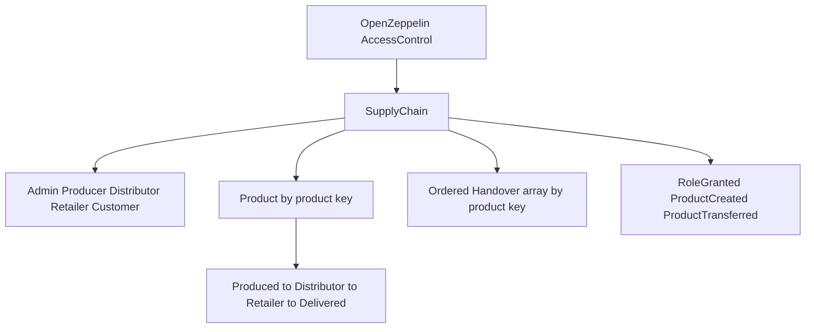

# Group Report Outline

DS441A Project 7, Team 5. Target: **five pages**, within the assignment's 4–6-page
limit. This is an assembly outline, not a paginated final report or a completed
gas analysis. Source records and full screenshot sets remain supporting appendices.

## Page 1 Introduction and system design

Owners: both members. Available text: [Quoc report](report-quoc.md),
[contract interface](CONTRACT_INTERFACE.md) and the implemented source.

Trace records the custody of a product from Producer to Distributor, Retailer and
Customer on a local Ganache blockchain. Registered wallets submit the state
changes through an English web interface with MetaMask. Any local reader can
inspect origin, holder and timestamped history by product ID or QR without a
wallet. The contract records submitted data and cannot verify physical authenticity.

Include a compact responsibility table and the small architecture diagram from
the Quoc report. State the tested environment and distinguish public RPC reads
from wallet-signed writes. Use a short introduction rather than a separate cover
page if a cover would displace required content.

## Page 2 Contract design and lifecycle

Owner: Huyen. **Awaiting final contract narrative and reviewed diagram.** Current
code supports the following outline; validate it against Huyen's final submission.

Explain Product fields, Handover entries and the mapping key derived from the
case-sensitive ID. Admin is independent of Producer; the deployer starts as Admin.
Each handover requires the current holder's active role and the next recipient
role. A revoked holder cannot hand over until the role is restored. Unknown IDs
return exists false and empty history. Delivered is terminal.

## Page 3 Frontend and integration evidence

Owner: Quoc. **Section available.** Condense [report-quoc.md](report-quoc.md).

Describe verified ABI/local-config export, BrowserProvider/Signer writes and
JsonRpcProvider reads pinned to one block. Summarize role gates, transaction
simulation and receipt confirmation, account-change invalidation, safe error
rendering, QR generation/decoding and camera cleanup. Include one readable timeline
or QR screenshot from the accepted fresh flow, with a caption and evidence path.

State the results concisely: 27 Hardhat tests, 25 frontend service tests and 13
isolated Edge cases passed. Actual MetaMask replay created STEP08-DEMO-001 at
block 10, transferred at 11–13 and ended Delivered with Customer and four entries.
Manual rejection, duplicate ID, invalid recipient and delivery gates, plus physical
QR scan/release, have original screenshots and chain evidence. Real disconnect/
reconnect and wrong-network recovery were waived and not run; simulated coverage
does not turn those into manual passes.

## Page 4 Security analysis and gas comparison

Owner: Huyen. **Awaiting final analysis, controlled measurements and optimization.**

Cover access control, input validation, role spoofing, revocation, public on-chain
data and the relevance of reentrancy to the actual code paths. Distinguish
frontend usability checks from contract enforcement, and state the trusted Admin
and immediate-transfer assumptions. Avoid claiming a complete security audit.

Reserve a compact table for measured baseline and optimized gas on equivalent
operations, followed by the change and measured mechanism. Use
[group-report-inputs.md](group-report-inputs.md) for the required conditions,
calculations and raw evidence. **Do not fill the comparison with the baseline UI
receipt values or claim improvement before the optimized results are supplied.**

If the security and gas content needs another page, use a six-page version while
preserving the assignment limit and readable diagrams/tables.

## Page 5 Results limitations and conclusion

Owners: both members. Available integration results can be summarized now;
the optimization conclusion remains **awaiting measurements**.

Summarize tested behavior, physical-world limitations, public data, local-chain
availability, trusted role registration, no receiver acknowledgement and lack of
product enumeration/public hosting. State explicitly what was waived. Add the
measured optimization outcome only after page 4's evidence is complete.

Provide compact references to [the contract test report](test_report.md),
[the integration matrix](verification/integration.md),
[the exact replay receipts](verification/integration-chain-replay.json),
[step 08 acceptance](reports/step-08-integration-acceptance.docx) and
[setup instructions](../README.md). Keep full raw logs and all ten screenshots
outside the five-page main report. Check the final pagination after rendering;
these proposed page allocations do not establish an actual final page count.
