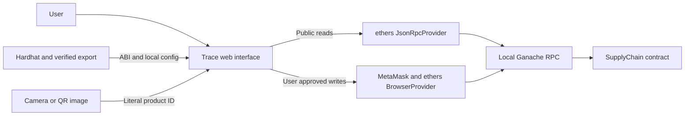

# Frontend Deployment and Integration Report

Author: Mai Nam Quốc, 29211145181. DS441A, Project 7, Team 5.
Verified local acceptance: 16 November 2026, Asia/Saigon.

## Purpose and implemented scope

Trace provides an English web interface for a role-controlled product custody
contract on local Ganache. An Admin registers participant roles. A Producer creates
a product and transfers it through Distributor and Retailer to Customer. Readers
enter a product ID or scan its QR to inspect the current holder and ordered history.
The implementation uses HTML, CSS and JavaScript with Vite 8.3.8, ethers 6.17.0,
qrcode 1.5.4 and html5-qrcode 2.3.8. No application backend is required.

Huyen owns the Solidity contract, access control, contract tests, gas measurement
and optimization. Quoc owns deployment integration, the frontend, wallet and QR
flows, acceptance evidence and README. Both members contribute to integration,
report assembly and demonstration. This division describes responsibility; it
does not establish Git authorship for uncommitted files.

## Deployment and configuration

Hardhat Ignition deploys SupplyChain using the Ganache node's unlocked test account.
The deployer receives DEFAULT_ADMIN_ROLE; the constructor does not also grant
Producer. The recorded baseline uses Solidity 0.8.34, Paris EVM and optimizer
disabled. The npm deploy script selects the default profile explicitly.

The export script reads the network URL from Hardhat, Chain ID from RPC, the
contract address from Ignition and the ABI from the compiled artifact. It compares
the current artifact against the recorded deployment, checks live bytecode and the
successful deployment receipt, and verifies the deployer's Admin role. Only then
does it write the ABI and local configuration. This catches stale deployment
addresses, mismatched profiles and workspaces with the same Chain ID but different
state.

`deployment.local.json` contains only contractAddress, rpcUrl and decimal chainId
as a string. It is machine-specific and ignored by Git, as are the Ignition
journals. The committed example has empty values and no usable placeholder
address. Optional raw-JSON loading validates a missing or malformed file at runtime,
so the app can show export instructions instead of failing the build. A workspace
reset or deliberate redeployment requires verification and a new export; products
do not migrate to another contract.

## Interface and communication flow

The interface has Overview, Product lookup, Operations, Access control and QR and
camera sections. Network status reports RPC, Chain ID and contract availability.
The wallet panel shows the active address and actual on-chain roles. Forms display
receipt status, hash and gas after a write transaction. These controls express
current permissions while Solidity remains the authority for every state change.

Public reads use a separate JsonRpcProvider and require no window.ethereum,
wallet connection or signing request. Product and history are read at the same
block to avoid showing a holder from one block and history from another. Unknown
IDs return exists false and an empty history. The page clears previous details
on unknown IDs, input changes and RPC failures; request generation guards prevent
an older response from replacing a newer result.

Writes use MetaMask through BrowserProvider and a Signer. Connect MetaMask is an
explicit user action. Before signing, the app rechecks the account, wallet/RPC
Chain IDs, bytecode, current role and custody conditions, then simulates the
operation with staticCall. Pending state prevents duplicate submission. The page
waits for a successful receipt before declaring confirmation; a hash alone is
not treated as success.

## Product lifecycle and authorization

| Stage | Value | Holder and allowed next action |
| --- | --- | --- |
| Not found | 0 | No product; no handover |
| Produced | 1 | Producer may transfer to Distributor |
| At distributor | 2 | Distributor may transfer to Retailer |
| At retailer | 3 | Retailer may transfer to Customer |
| Delivered | 4 | Customer is final holder; no further transfer |

Admin grants the four participant roles to their public wallet addresses. Account
names in MetaMask do not grant permissions. A single account may hold multiple
roles, but it must still follow the stage order and cannot transfer to itself.
The sender must be the current holder with the required role; the recipient must
have the next role. A revoked sender remains holder but cannot hand over until
the role is restored. Transfer is effective immediately, with no recipient
acknowledgement. The frontend does not expose revoke/renounce or extra Admin grants.

Create, handover, lookup and QR inputs are trimmed. Their case is preserved, and
the original product-ID string is sent to contract methods. The contract itself
does not trim. The browser does not hash the ID before calling getProduct or
getHistory. Each creation is shown as initialization from the zero address; the
remaining entries preserve the contract array order, even with equal timestamps.
BigInt timestamps are converted safely from seconds for local date display.

## QR scanning and camera lifecycle

Generated PNGs encode only the product ID. Readers can download the image or show
it on a phone/printout to the computer webcam. A computer's localhost address does
not point to that computer when opened on a separate phone. QR text is treated as
a literal ID, including text resembling a URL or HTML; it is not opened or executed.
Product data is rendered as text rather than injected HTML.

Camera access starts only after Open camera. The scanner serializes start and stop,
guards repeated callbacks and stops/releases the camera before querying a decoded
ID. Stop camera, page/tab departure, navigation away and leaving the QR section
also clean up the stream. Permission denial, no camera and device-busy errors have
English feedback. Image-file decoding is available as a fallback and is recorded
separately from physical webcam acceptance.

## Errors and account changes

Account, chain and disconnect events invalidate the writer immediately. Async
generation checks prevent stale role reads from restoring an obsolete signer.
Wrong-network writes are locked. An explicit switch action can request the
configured local chain; no automatic signature or permission request is made after
disconnect. Frontend errors distinguish wallet rejection, unavailable RPC,
insufficient funds, custom access-control errors and contract preflight rejection.

One integration defect initially stopped application startup: a BigInt Chain ID in
a plain ethers network object was rejected. The product reader now constructs an
ethers Network instance, with a regression test using the real constructor.
Startup failures also produce a visible application error instead of remaining
at Checking network. The repaired app was confirmed on the user's Edge page.

## Verification and actual acceptance

The step 08 verification ran default-profile compile, root typecheck, 27 isolated
Hardhat contract tests, 25 frontend service tests, production build and verified
deployment export successfully. Thirteen isolated Edge checks cover public reads,
missing/unconnected wallet, simulated account/network events and rejection,
duplicate/holder/Delivered gates, safe RPC interruption and QR image decoding.
All commands and exit codes are retained in
[integration-checks.json](verification/integration-checks.json).

Quoc performed the actual MetaMask replay with a fresh ID, STEP08-DEMO-001.
The creation and each handover have successful receipts and exact event/history
timestamps, independently verified against their block timestamps:

| Operation | Block | Gas used | Block timestamp |
| --- | --- | --- | --- |
| Create product | 10 | 146937 | 1794770899 |
| Producer to Distributor | 11 | 87258 | 1794771061 |
| Distributor to Retailer | 12 | 87526 | 1794771162 |
| Retailer to Customer | 13 | 87794 | 1794771228 |

Customer holds the Delivered product with four history entries. Original
screenshots establish actual wallet rejection with no broadcast, duplicate-ID
and invalid-recipient preflight rejection, former-holder and final Customer gates,
the complete timeline and fresh physical QR decoding with camera release.
See [the acceptance report](reports/step-08-integration-acceptance.docx),
[integration matrix](verification/integration.md),
[live chain audit](verification/integration-chain-replay.json) and
[original screenshot manifest](verification/integration-screenshots/manifest.json).

Step 08 closed under Quoc's approved scope. Actual disconnect/reconnect and
wrong-network/return were explicitly waived and not run; their simulated results
are not manual passes. Contract tests alone do not prove MetaMask signing;
file decoding and synthetic camera streams alone do not prove a physical webcam.

## Limits and remaining group work

The blockchain cannot validate physical origin, goods or receipt. Data is public,
the local Admin is trusted to register roles, and custody transfer requires no
receiver signature. The app has no product enumeration API, full identity system,
public hosting or backend. QR possession does not authorize a transfer. Local
Ganache loss/reset can remove the demo data and requires restoring or redeploying
the matching environment.

The receipt gas above belongs to one unoptimized baseline run. It is not a measured
before/after comparison. Huyen must provide the gas measurements and explanation
of the implemented optimization, plus the final contract/security report section.
[The group inputs](../trash/docs/group-report-inputs.md) and
[five-page outline](../trash/docs/group-report-outline.md) record these open items. The final
4–6-page group report and clean-copy/demo rehearsal are not claimed complete.
